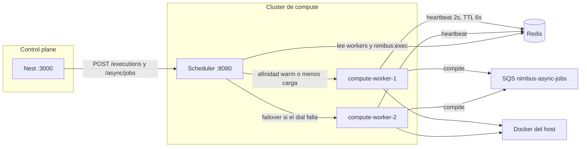

# Scheduler y varios workers de compute (Paso 7b)

Un solo proceso de compute plane ejecuta todo lo que Nest le manda. Para crecer de a una máquina, el mismo contrato HTTP lo atiende un scheduler en Go y lo reparte entre workers. Nest no cambia de código: en este modo `COMPUTE_PLANE_URL=http://scheduler:8080`.

`make up` sigue siendo un solo compute plane. Este modo es `make up-multi`.

## Arquitectura



Cada worker es el mismo binario del compute plane. Anuncia en Redis quién es, cuántas ejecuciones tiene abiertas, el tope de containers y las claves warm que tiene ociosas. El scheduler no ejecuta código de usuario y no abre Docker.

La cola async no pasa por el scheduler en el momento de correr: cualquier worker sano recibe el `POST /async/jobs` y lo deja en SQS. Los dos procesos hacen long poll de `nimbus-async-jobs`. El resultado sigue publicándose en `nimbus:async:results` para que Nest actualice la fila.

## Registro

| Key | Qué guarda |
|-----|------------|
| `nimbus:worker:{workerId}` | JSON del heartbeat, con TTL |
| `nimbus:workers` | Set de ids. Si la key del heartbeat venció, el listado la saca |
| `nimbus:exec:{executionId}` | El campo `workerId` lo escribe el worker cuando admite o encola la ejecución |

El JSON del heartbeat:

```json
{
  "workerId": "compute-worker-1",
  "url": "http://compute-worker-1:8080",
  "activeExecutions": 1,
  "maxContainers": 8,
  "idleWarmKeys": ["fn:version:nodejs20:configHash"],
  "state": "healthy"
}
```

`state` es `healthy` o `draining`. Un `SIGTERM` publica `draining` (el scheduler deja de mandarle trabajo nuevo y todavía puede cancelar) y, al terminar lo que estaba en curso, borra la key. Un `SIGKILL` no llega a eso: a los 6 segundos la key vence y el scheduler deja de verlo.

La clave warm es `functionId:version:runtime:configHash`. `configHash` cubre handler, memoria, CPU y variables de entorno. El timeout no entra, igual que en el pool. El scheduler calcula la misma clave con los mismos defaults (`NIMBUS_TIMEOUT_SEC`, `NIMBUS_MEMORY_MB`, `NIMBUS_HANDLER`, `NIMBUS_CPUS`).

Cada respuesta del worker lleva `X-Nimbus-Worker`. El scheduler la reenvía.

## A quién se le manda un POST /executions

1. Quedan los workers con heartbeat vivo, `state=healthy` y `active < maxContainers`. `active` suma las rutas que este proceso ya entregó y todavía no terminaron: el heartbeat va cada 2 segundos y, si no se contaran, un burst paralelo caería todo en el mismo worker.
2. **Afinidad warm.** Si alguno de esos anuncia un sandbox ocioso para la clave de este request, se elige entre ellos el de menor carga.
3. **Menos carga.** Si no hay afinidad, gana el de menor `active / maxContainers`. Si el cociente empata, gana el que tiene menos `active`. Si eso también empata, gana el id más chico.
4. **Failover.** Si conectar con el elegido falla antes de que haya una respuesta HTTP, se intenta **una** vez con otro worker sano. Si ese también falla el dial, la respuesta es 503. Un 4xx o un 5xx del worker no se reintenta: la ejecución puede haber empezado.

`POST /executions/:id/cancel` lee `workerId` en `nimbus:exec:{id}` y reenvía solo a ese worker. Si no hay id, o ese worker ya no tiene heartbeat, el scheduler pregunta a los que siguen vivos y se queda con la respuesta que trae `cancelled: true`.

`POST /async/jobs`, `GET /dlq` y `POST /dlq/:id/redrive` van a cualquier worker sano (el de menor carga). También reintentan una vez si el dial falla.

`GET /workers` devuelve el listado. `GET /health` responde `service: scheduler` y `workersHealthy`. `GET /metrics` expone:

| Serie | Significado |
|-------|-------------|
| `nimbus_scheduler_routes_total{worker,reason}` | Rutas entregadas. `reason` es `warm`, `least_loaded`, `failover`, `cancel`, `broadcast` o `any` |
| `nimbus_scheduler_workers_healthy` | Workers con heartbeat vivo y `state=healthy` |

El scheduler abre el span `scheduler.route` y propaga `traceparent`.

## Cómo levantarlo

```bash
make up-multi
make cluster-check
make down-multi
```

`make up-multi` construye las imágenes de runtime, levanta Postgres, Redis, LocalStack, el scheduler, dos workers, Nest y la consola. El puerto `:8080` del host es el scheduler. Los workers no publican puerto: se hablan por la red de compose (`http://compute-worker-1:8080` y `http://compute-worker-2:8080`).

`make cluster-check` exige los dos workers, un invoke por Nest, el reparto en paralelo, la afinidad warm, el burst async en los dos procesos, un cancel sobre el worker que tiene la ejecución, y un `SIGKILL` del worker 2. Después de esa prueba el worker 2 queda muerto. `make down-multi` baja el proyecto.

`make up` no usa este archivo. Sigue siendo un compute plane solo. `make down-multi` también borra los sandboxes que los workers dejaron en el daemon (un `SIGKILL` no llega a apagarlos).

Los dos workers comparten el daemon de Docker y `/tmp/nimbus-work`. Cada uno etiqueta sus containers warm con `nimbus.worker` y extrae el zip en su propio subdirectorio, así el arranque de uno no borra el pool del otro. El semáforo por función sigue siendo una sola key de Redis para todo el cluster. El tope `NIMBUS_MAX_CONTAINERS` es de cada proceso.

En este compose cada worker corre con `NIMBUS_ASYNC_WORKERS=1`. El proceso toma un mensaje y lo ejecuta antes de pedir otro, y así el otro nodo alcanza a leer la misma cola en LocalStack.

## Variables

| Variable | Default | Quién | Efecto |
|----------|---------|-------|--------|
| `NIMBUS_WORKER_ID` | hostname | worker | Id estable. En compose: `compute-worker-1` y `compute-worker-2` |
| `NIMBUS_WORKER_URL` | `http://{id}:{PORT}` | worker | URL a la que el scheduler hace el dial |
| `NIMBUS_HEARTBEAT_INTERVAL_MS` | `2000` | worker | Cada cuánto se refresca el registro |
| `NIMBUS_HEARTBEAT_TTL_MS` | `6000` | worker | Vida de la key. Tiene que ser mayor que el intervalo |
| `COMPUTE_PLANE_URL` | `http://scheduler:8080` | Nest, solo en este compose | Mismo cliente de siempre |

El scheduler usa los mismos defaults de función que los workers para armar la clave warm. Si se cambia `NIMBUS_MEMORY_MB` o `NIMBUS_HANDLER`, hay que ponerlo en los tres servicios.
