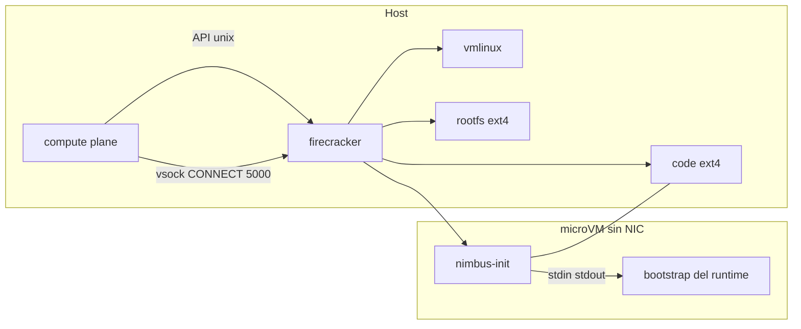

# Firecracker en el compute plane

El compute plane sigue arrancando en Docker. `NIMBUS_ISOLATION=firecracker` cambia el sandbox por un microVM y deja el resto del contrato igual: one-shot y warm, timeout, memoria, vCPU, variables, handler, runtime, logs en `nimbus:logs:{executionId}`, cancel, trace id y la etiqueta `isolation` en las métricas.

`make up` no carga este modo. Hace falta `/dev/kvm`.

## Arquitectura



El host y el guest hablan el mismo protocolo de líneas JSON que un container warm (`ready`, `log`, `done`, `fatal`). El canal es un vsock: el host hace `CONNECT 5000` sobre el socket Unix de Firecracker y, a partir de ahí, es un stream. No hay dispositivo de red. Eso es el equivalente de `--network=none`.

Cada runtime tiene un rootfs ext4 armado desde la imagen que ya usa Docker (`docker export` y `mkfs.ext4 -d`). Adentro se copia `/sbin/nimbus-init`, un binario estático que es el PID 1. El kernel es el vmlinux de CI de Firecracker (6.1.188, pineado en `scripts/fc-prepare.sh`).

El código de la función va en un segundo disco, de solo lectura. Layout: `/nimbus.json` (argv, env, uid) y `/task/` con el zip descomprimido. El init lo monta en `/mnt/code` y hace bind de `/task` en `/var/task`. El root también es de solo lectura.

El pool warm es el mismo de Docker. Una VM queda viva entre invokes. No hay snapshot/restore: el warm es no matar el proceso. `NIMBUS_WARM=0` bootea, invoca una vez y destruye. Ese camino reporta `initMs` (el boot). El one-shot de Docker sigue reportando 0.

Timeout y cancel mandan `SIGKILL` al grupo del proceso de Firecracker. La VM no vuelve al pool.

`memoryMb` es el tope del proceso, no el tamaño crudo de la VM. El microVM mide `memoryMb + 64` MiB: esos 64 quedan para el kernel y para init. El runtime entra en un cgroup (`memory.max` = `memoryMb`). Si el cgroup no está, un loop mira el RSS y manda `SIGKILL` al grupo. `oom_score_adj=-1000` se escribe en init después del `exec`: el valor se hereda, y ponerlo antes dejaba al runtime también fuera del OOM killer. El init no sale enseguida: un reboot del guest (`panic=1`) tira los bytes del vsock que el host todavía no leyó. Con el frame `fatal` de exit 137 el texto es el mismo que en Docker (`límite de memoria`).

`cpus` no es una cuota CFS adentro del guest. El API de Firecracker pide 1 o un número par de vCPU: hasta 1 queda en 1, por encima redondea al par siguiente y el tope de la plataforma es 4. Un `cpus: 0.5` arranca igual con 1 vCPU. Un `cpus: 2` se ve como dos CPUs (`os.cpus().length`).

El jailer (`NIMBUS_FC_JAILER=1`) mete a Firecracker en chroot, uid 123 y cgroup v2. Con `--new-pid-ns` el proceso del jailer sale enseguida: Firecracker queda como init del namespace nuevo y el compute plane espera el socket, no a ese padre. Si el cgroup no delega, el arranque falla y no hay fallback silencioso. El default sigue apagado: el rootfs no siempre se puede hardlinkear al jail y hay que copiarlo.

## Cómo correrlo

En el host, con KVM usable por el usuario que ejecuta los comandos:

```bash
make up-fc
make fc-check
```

`make up-fc` corre `scripts/fc-prepare.sh` y después `docker compose` con `docker-compose.firecracker.yml`. Ese override deja el compute plane privilegiado, le pasa `/dev/kvm` y monta el kernel, los rootfs y los binarios de Firecracker v1.18.0. El resto del stack (Postgres, Redis, MinIO, Nest, consola) no cambia.

`make fc-check` exige `GET /health` con `"isolation":"firecracker"`. Mide hello cold y warm de `nodejs20`, `python3.12` y `go1.x`, y prueba timeout 124, OOM, error de handler, cancel, ausencia de red, logs en Redis mientras el POST sigue abierto, `cpus: 2` y el one-shot con `NIMBUS_WARM=0`.

Para la columna Docker de la misma medición, con el stack de `make up`:

```bash
FC_BENCH_DOCKER=1 ./scripts/fc-check.sh
```

Eso solo corre el hello cold/warm y escribe `/tmp/nimbus-bench-docker.tsv`. No cambia el aislamiento.

Variables:

| Variable | Default | Rol |
|---|---|---|
| `NIMBUS_ISOLATION` | `docker` | `docker` o `firecracker` |
| `NIMBUS_FC_BIN` | `/usr/local/bin/firecracker` | Binario del VMM |
| `NIMBUS_FC_JAILER_BIN` | `/usr/local/bin/jailer` | Binario del jailer |
| `NIMBUS_FC_JAILER` | apagado | `1` / `true` / `on` lo enciende |
| `NIMBUS_FC_KERNEL` | `/var/lib/nimbus/fc/vmlinux` | Kernel guest |
| `NIMBUS_FC_ROOTFS_DIR` | `/var/lib/nimbus/fc/rootfs` | `{nodejs20,python3.12,go1.x}.ext4` |

Un valor distinto de `docker` o `firecracker` corta el proceso al arrancar.

## Números

Medidos en esta VM (KVM anidado, kernel guest 6.1.188, Firecracker v1.18.0, pedido de 128 MiB, jailer apagado). Cada cold es una clave nueva del pool, con el zip ya descargado. La mediana sale de tres muestras. `initMs` del warm es 0 en los dos backends. `initMs` del cold cuenta desde que empieza el sandbox (el `docker run`, o el armado del disco de código más el boot) hasta el frame `ready`.

| Runtime | Docker cold | Docker init | Docker warm | Firecracker cold | Firecracker init | Firecracker warm |
|---|---:|---:|---:|---:|---:|---:|
| nodejs20 | 190 | 130 | 38 | 1278 | 1242 | 1 |
| python3.12 | 283 | 213 | 38 | 1346 | 1285 | 1 |
| go1.x | 147 | 94 | 36 | 1177 | 1126 | 1 |

Tiempos en milisegundos. El cold de Firecracker es el boot de la microVM: cerca de 1,1–1,3 s en los tres runtimes. El warm, con la VM ya viva, queda en 0 o 1 ms. En Docker el cold es el arranque del container (94–213 ms de init) y el warm del hello queda cerca de 36–38 ms.

En la misma corrida, además del hello: timeout de Python en 2048 ms con exit 124 y el siguiente invoke en frío; OOM de Python y de Go con exit 137 y el texto de límite de memoria; un error de handler (`boom`) reutiliza la VM; cancel de Node en 1737 ms con HTTP 409, exit 130 y la VM fuera del pool; Python en uid 1000, trace id, `/var/task` de solo lectura, `/tmp` escribible y el dial a `1.1.1.1:443` rechazado; Node sin interfaces de red; la línea de log en Redis con el POST todavía abierto; `cpus: 2` visto como 2; `memoryMb: 64` arrancó (la VM queda en 128 MiB y el cgroup en 64); one-shot (`NIMBUS_WARM=0`) de Node con `initMs` 1276, `durationMs` 1342 y uid 1000.

Un hello de Node con el jailer prendido, fuera de esa tabla, dio `initMs` 1522 y `durationMs` 1539, uid 1000. El default no cambia.

## Límites

- Sin NIC. Un dial a `1.1.1.1:443` falla. `os.networkInterfaces()` no tiene `eth0`.
- El root y `/var/task` quedan de solo lectura. `/tmp` es un tmpfs de 16 MiB.
- El proceso del runtime corre como uid 1000 en cold, warm y one-shot. En Docker, Node en el camino frío (`NIMBUS_WARM=0`) sigue como root y el `initMs` de ese camino es 0.
- `cpus` fraccionario no achica el tiempo de CPU del guest. Solo cambia el número de vCPU, y ese número es 1 o par.
- `memoryMb` 64 es el mínimo de la plataforma y el tope del cgroup. La VM suma 64 MiB de reserva del kernel. Un pedido de 64 arrancó. El tope del proceso no se sube.
- Las variables de entorno viajan en el ext4 del código mientras la VM existe. Es la misma ventana que `docker inspect` en el otro backend.
- El rootfs se arma en el host (`make fc-prepare` / `make up-fc`), no en cada invoke. El ext4 del código sí se arma en el compute plane, con `mkfs.ext4`.
- `/dev/kvm` y el contenedor privilegiado están solo en el override. `make up` no los pide.
- No hay snapshot/restore. El warm mantiene la VM prendida. La RAM del host es `memoryMb` más los 64 MiB del kernel, por slot.
- El job de CI `firecracker-kvm` solo mira si el runner tiene `/dev/kvm` y sale 0 igual. `make fc-check` no corre en GitHub: el job de compose sigue en Docker.

## Qué no entra

Nest no conoce `NIMBUS_ISOLATION`. La consola tampoco. El campo `runtime` sigue sin persistirse en el control plane: el invoke de estos checks pega a `:8080`.
