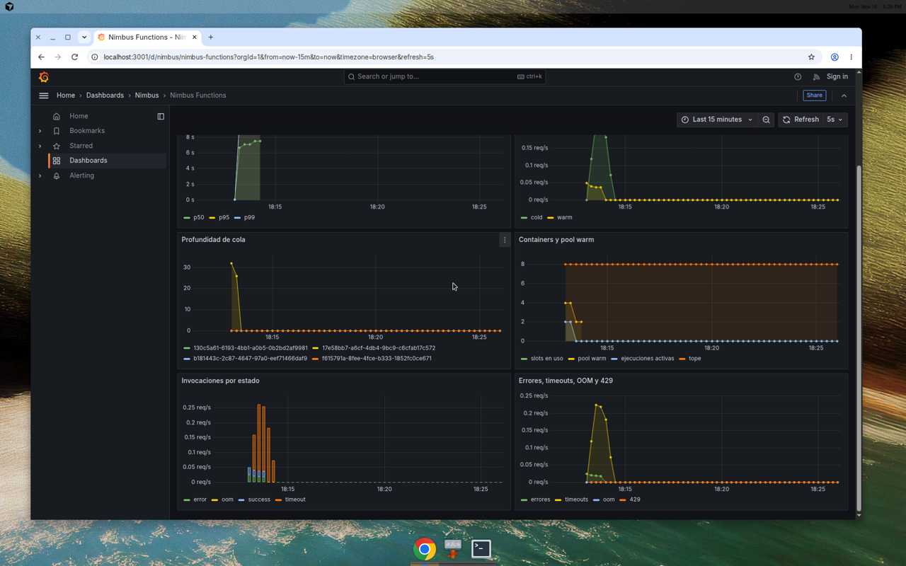
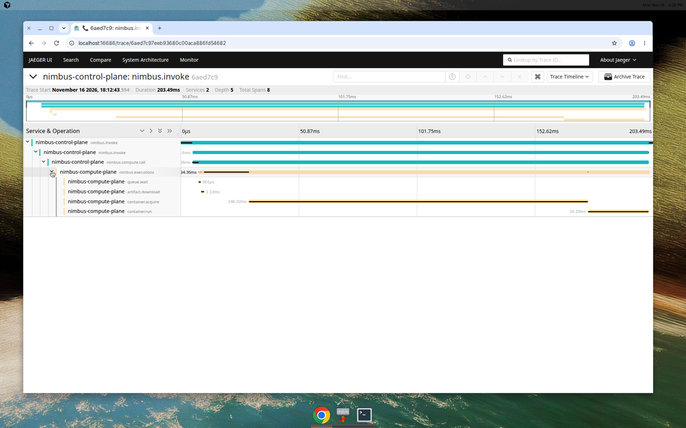

# Observabilidad (Paso 5)

El compute plane expone métricas de Prometheus y trazas OpenTelemetry. El control plane suma un `/metrics` de HTTP y propaga `traceparent` hasta Go. Prometheus, Grafana, Jaeger y el collector viven en un perfil de Compose aparte: `make up` no los levanta.

## Cómo verlo

Con el stack del MVP ya arriba:

```bash
make obs          # Prometheus, Grafana, Jaeger y el collector
make obs-check    # genera tráfico y consulta las tres APIs
```

| Qué | URL |
|-----|-----|
| Grafana (viewer anónimo) | http://localhost:3001 |
| Dashboard | http://localhost:3001/d/nimbus/nimbus-functions |
| Jaeger | http://localhost:16686 |
| Prometheus | http://localhost:9090 |
| Métricas del compute plane | http://localhost:8080/metrics |
| Métricas del control plane | http://localhost:3000/metrics |
| OTLP HTTP (collector) | http://localhost:4318 |

Grafana no pide login en local: el acceso anónimo entra como Viewer. El usuario `admin` / `admin` sigue existiendo. El datasource Prometheus y el dashboard `nimbus` se cargan solos al arrancar.

`make obs-check` no corre en CI. El job de compose sigue con `hello`, `smoke`, `config-check`, `warm-check` y `async-check`. El perfil obs baja cuatro imágenes más y no hace falta para esos checks.

## Métricas del compute plane

El endpoint es `GET /metrics`. Las etiquetas usan `function_id`. No hay `execution_id`: un id por invocación haría crecer la serie sin límite.

| Métrica | Tipo | Etiquetas | Qué mide |
|---------|------|-----------|----------|
| `nimbus_invocations_total` | counter | `function_id`, `status`, `mode` | Invocaciones que pasaron la admisión. `status` es `success`, `error`, `timeout`, `oom` o `cancelled`. `cancelled` es un `POST /executions/:id/cancel` que alcanzó a cortar el container (exit 130). `mode` es `sync` o `async`. |
| `nimbus_errors_total` | counter | `function_id`, `mode` | El handler falló y no fue timeout ni OOM. |
| `nimbus_timeouts_total` | counter | `function_id`, `mode` | Exit 124. |
| `nimbus_ooms_total` | counter | `function_id`, `mode` | Exit 137, 134, o el texto de límite de memoria. |
| `nimbus_invocation_duration_seconds` | histogram | `function_id`, `mode` | Tiempo después de conseguir el slot (`durationMs`). |
| `nimbus_cold_starts_total` | counter | `function_id` | Esta invocación arrancó un container. |
| `nimbus_warm_starts_total` | counter | `function_id` | Reutilizó uno del pool. |
| `nimbus_init_duration_seconds` | histogram | `function_id` | `initMs` de un cold start. Un warm y el camino frío de un solo uso (init 0) no entran. |
| `nimbus_queue_depth` | gauge | `function_id` | Invocaciones esperando en la cola FIFO. Se lee de Redis en cada scrape. Si la función ya corrió y la cola está vacía, el valor es 0. |
| `nimbus_queue_wait_seconds` | histogram | `function_id` | `queuedMs`, también en un 429. |
| `nimbus_active_executions` | gauge | `function_id` | Ejecuciones que tienen un slot ahora, en este proceso. |
| `nimbus_warm_pool_size` | gauge | `function_id`, `state` | Containers del pool. `state` es `idle` o `busy`. |
| `nimbus_containers_in_use` | gauge | — | Slots vivos de esta máquina (`nimbus:slots:machine:*` con lease vigente). Los warm ociosos no entran: están en el pool. |
| `nimbus_containers_limit` | gauge | — | `NIMBUS_MAX_CONTAINERS`. |
| `nimbus_rejections_total` | counter | `function_id`, `reason` | HTTP 429. `reason` es `queue_full` o `queue_timeout`. No suma a `nimbus_invocations_total`: no llegó a correr. |
| `nimbus_async_retries_total` | counter | `function_id` | Reintentos programados. El primer intento no cuenta. |
| `nimbus_dlq_entries` | gauge | — | Tamaño actual del hash de la DLQ. |

El dashboard grafica invocaciones por segundo, la tasa de error, p50/p95/p99 de la duración, cold contra warm, la profundidad de la cola, la DLQ y los containers.

## Métricas del control plane

Cambio chico de Nest, listado abajo. `GET /metrics` expone:

| Métrica | Tipo | Etiquetas |
|---------|------|-----------|
| `nimbus_http_requests_total` | counter | `method`, `route`, `status` |
| `nimbus_http_request_duration_seconds` | histogram | `method`, `route` |

`route` es el path con los UUID reemplazados por `:id`. `/metrics` no se cuenta a sí mismo.

## Trazas

El camino de un invoke sync:

```
nimbus.invoke            control plane, el POST /functions/:id/invoke
  nimbus.compute.call    cliente HTTP hacia Go, inyecta traceparent
    nimbus.executions    POST /executions
      queue.wait
      artifact.download
      container.acquire  arranque o toma de un container warm
      container.run      el handler
```

Un async guarda `traceparent` y `tracestate` en el job de Redis (`nimbus:async:jobs`). El worker los lee y abre `async.attempt` como hijo del enqueue (`nimbus.async.enqueue`). Los reintentos siguen en la misma traza. Después vienen los mismos spans de cola, descarga y container.

Dentro del container van dos variables:

| Variable | Qué es |
|----------|--------|
| `NIMBUS_TRACE_ID` | El trace id de 32 hex. |
| `TRACEPARENT` | El header W3C del span padre. |

En el camino frío van en `docker run -e`. En el warm el proceso se reutiliza y `docker -e` queda fijo en el arranque: cada invoke manda `traceId` y `traceparent` en la línea JSON de stdin, y el bootstrap los publica en `process.env` para esa llamada. El bootstrap escribe en el log `[nimbus] traceId=… traceparent=…`. Go también escribe esa línea en el stream de la invocación. `NIMBUS_TRACE_ID` está reservado, igual que el resto de `NIMBUS_*`.

La exportación es OTLP HTTP hacia el collector, y el collector reenvía a Jaeger. El procesador es por lotes (1s). Si el collector no está, el error queda en segundo plano y la invocación sigue. Como mucho se loguea una vez cada 30s.

## Variables

| Variable | Default | Efecto |
|----------|---------|--------|
| `NIMBUS_TRACING` | prendido | `0`, `false`, `off` o `no` no instalan el exporter. |
| `OTEL_SDK_DISABLED` | — | `true` también lo apaga. |
| `OTEL_EXPORTER_OTLP_ENDPOINT` | `http://otel-collector:4318` | Base del collector. Se le agrega `/v1/traces` si falta. |
| `OTEL_SERVICE_NAME` | `nimbus-compute-plane` en Go, `nimbus-control-plane` en Nest | Nombre en Jaeger. |

## Cambios en el control plane

Federico sigue siendo el dueño de Nest. Acá el diff es el mínimo para que la traza salga del invoke y para tener `/metrics`:

- `src/observability/tracing.ts`: provider OTLP, apagable, y un middleware que abre un span de servidor.
- `src/observability/metrics.ts` y `metrics.controller.ts`: los dos contadores HTTP y `GET /metrics`.
- `src/main.ts`: registra el middleware.
- `src/functions/runner.service.ts`: span `nimbus.invoke` y `nimbus.compute.call`, e inyecta `traceparent` en `POST /executions` y `POST /async/jobs`.
- `src/app.module.ts`: el controller de métricas.

No hay columnas nuevas en Prisma. El body de `POST /executions` no cambia. El header `traceparent` es opcional: un cliente que no lo manda sigue igual, y Go abre una traza raíz.

## Prueba

```bash
make up
make obs-check
```

Eso levanta el perfil obs y comprueba, contra las APIs:

- invokes sync (el segundo reutiliza el container), un async que termina en SUCCESS, un handler que lanza, un timeout, un OOM, un async que agota los intentos y queda en la DLQ, y una ráfaga que recibe 429 sin reiniciar el proceso
- Prometheus devuelve esas series con valor real
- Grafana tiene el dashboard `nimbus` provisionado
- Jaeger tiene una traza cuyo id está en los logs del container, con spans del control plane, del compute plane y `container.run`

Capturas de esa corrida:




